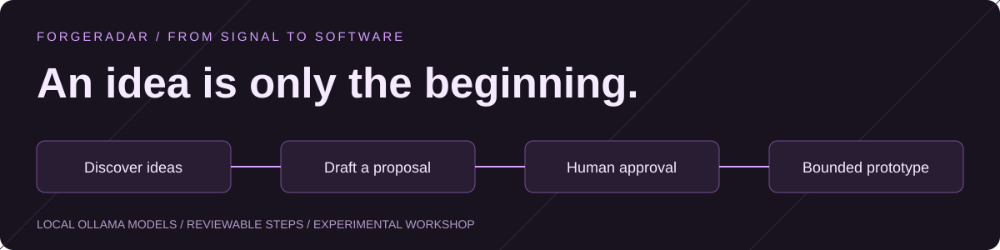

# ForgeRadar

**Hosted owner dashboard:** [forgeradar.onrender.com](https://forgeradar.onrender.com/). It uses the Eclipse sign-in page and requires the workshop password. The V3 account and profile workspace currently runs on the owner's laptop at `http://127.0.0.1:4317/`; it is not hosted on Render.

The [Android source](android/README.md) is a secure mobile shell for the hosted owner dashboard. No APK has been built or device-tested in this checkout; that requires the Android SDK and its license. The Android app uses the live site and cannot run the laptop's local AI when the worker is offline.

A local agent system for discovering software ideas, evaluating who would use them, proposing projects, building offline prototypes or persistent Node + SQLite applications, and syncing each approved project to its own private GitHub repository.

Discovery includes **unbuilt community ideas**, unmet needs and improvements to existing tools. A popular existing repository is context, not automatic proof that copying it would be worthwhile. Novelty remains unverified until researched, and a limited search cannot prove that no product exists.

## Agent circuit

`Scout → Miner → Evaluator → Critic → Proposal → Architect → Builder → QA → GitHub Sync`

Each role has separate instructions, validated outputs and explicit handoffs. Roles share one locally running model and execute in dependency order. The console displays actual engine states through server-sent events, agent inputs and outputs, handoff payloads and an event trail. Animation reflects running stages; there are no simulated agent events.

- **Scout:** collects community signals and imports.
- **Miner:** extracts feasible ideas, classifies their origin and links source evidence.
- **Evaluator:** estimates merit, audience fit, career value, feasibility and adoption potential.
- **Critic:** searches GitHub and Hacker News for existing-solution signals, questions demand and revises competition/novelty estimates.
- **Proposal:** writes a short proposal and explains the choice relative to alternatives.
- **Architect:** defines supported application scope and acceptance checks.
- **Builder:** generates offline interfaces, or a validated data model compiled into a reviewed Node + SQLite backend and accessible browser interface.
- **QA:** checks syntax and offline scope for prototypes. Persistent applications also run database CRUD, input-validation and restart-persistence acceptance tests before publication. Domain workflows still require owner review.
- **GitHub Sync:** creates a private repository per generated project and commits each changed snapshot atomically, without force-pushing.

## Run locally

Requires Node.js 24+ and Git. No npm packages are required.

On Windows, run `./start.ps1` in PowerShell. It launches the engine in the background and starts an available Ollama runtime. Open http://127.0.0.1:4317.

Alternatively, start Ollama separately and run `node server.mjs`.

`./start.ps1` also starts validated, completed Node/SQLite project sites on separate loopback ports. Their current addresses are recorded in the private `data/local-project-ports.json`; use **Projects → Open site in new tab** for an authenticated preview within ForgeRadar. A GitHub repository holds source code but does not keep its `localhost` server running. The standalone project links work only while this laptop and those project processes are on.

### V3 local accounts and profile

Open the local address and sign in. On the existing owner's laptop, the first owner account is `owner@forgeradar.local` with the existing workshop password; the password is hashed in the local SQLite database. On a clean installation without prior deployment credentials, the first registered account becomes the owner. Other local accounts have separate private profile rows and cannot access the legacy owner workspace or its project APIs. The existing remote Render dashboard still has its separate owner password; member profiles are local until the V3 remote-access phase is complete.

The V3 profile page lets each account select and exclude interests, review claimed skills and portfolio projects, save with consent, export data or delete the profile. GitHub portfolio preview uses only GitHub's public REST API after you enter a profile URL and click review. It reads at most 30 public repositories, caches for one hour, and saves only selections you make. Public profile ownership is not verified by this import.

The local V3 screen also offers explicit OpenAlex/Crossref research refreshes based only on selected domain names. The feed excludes unselected or excluded domains before ranking. Its scores and related-work matches are limited heuristics, not proof of originality or demand. You can save, dismiss, restore, and compare cached sources per account. Project Studio stores editable proposal drafts and manual tasks; approving a proposal enables planning but does not start a build, create a GitHub repository, or publish. Marking a task done requires test evidence or a human sign-off note. The export includes your profile, appearance, discovery feedback, proposals, and tasks. Deleting the profile removes profile fields only; other workspace data remains until a separate account-data deletion flow is implemented.

For approved proposals, **Suggest tasks with local model** asks the installed Ollama model for at most five review-only tasks. No task is inserted until you accept it. The planner pauses when less than 1.2 GiB system RAM is free, and manual tasks continue to work without Ollama. Run `node smoke-local-planner.mjs` for an optional disposable local-model integration check; it never touches the live account database.

Approved V3 proposals also support typed task blockers and task history. A task cannot be marked done before its blockers, and cycles are rejected. **Build private data workspace** asks the installed local model for a bounded collection schema, compiles a Node + SQLite application, and runs syntax plus CRUD acceptance tests. Only a passing build becomes an account-scoped private preview. This path handles typed data workflows; it does not claim to implement arbitrary domain-specific algorithms or external integrations. **Review release readiness** inspects the actual files, hashes, incomplete tasks, README and possible secrets/branding. A separate owner-only final confirmation can create a private GitHub repository, push the reviewed files, verify its commit and then make it public. This path has mocked tests but has not published a real V3 project. A dynamic application receives a code URL, not a GitHub Pages website.

Each signed-in V3 account automatically checks the local AI runtime on the ForgeRadar host. An installed model is shared across accounts with sequential execution. If Ollama or a model is missing, onboarding shows a device-sized model suggestion and the host setup command; manual planning remains available. A browser on another device cannot install software there, and ForgeRadar does not silently download models. Eclipse is the sole V3 theme; reduced motion remains a per-account preference.

For other authorized devices, see [private remote access](docs/PRIVATE_REMOTE_ACCESS.md). Tailscale Serve application support is prepared but not activated; the app remains loopback-only and cross-device V3 access has not yet been verified.

Résumé preview parses PDF or DOCX locally and deletes the temporary uploaded file immediately. It offers editable suggestions with source lines; it never silently saves them or treats CV claims as verified skills. Install Python 3 and the free packages with `python -m pip install pypdf python-docx` on a clean laptop. Set `FORGERADAR_PYTHON` to the Python executable when it is not on PATH. Manual onboarding works without Python. The parser rejects files over 6 MB, encrypted/active PDFs and macro or oversized DOCX archives. Scanned image PDFs need manual entry.

Run `./install-worker.ps1` once on Windows to install the current-user startup shortcut and recovery supervisor. It starts at Windows sign-in and checks the engine, model and bridge every 30 seconds. Remove **ForgeRadar Worker.lnk** from your Startup folder to disable automatic startup. This installation uses no administrator privilege and does not run while Windows is off.

Install Ollama from https://ollama.com/download and pull a local model that fits your available memory. The launcher can use an Ollama installation on PATH. Model speed depends on your machine.

### First local session

1. Install Node.js 24+, Git, and Ollama. Pull a model supported by your machine and confirm Ollama can answer locally.
2. On Windows, launch `./start.ps1`; otherwise start Ollama yourself and run `node server.mjs` from the repository root.
3. Open http://127.0.0.1:4317 and wait for the engine and model status to become ready.
4. Use the workshop composer to request discovery or describe an idea. Review the sourced evidence, score, proposal, architecture, and QA results in the circuit.
5. When a proposal is ready, choose its build mode and explicitly approve it. Inspect the generated files and QA report before syncing; approved generated projects are published to their own private repositories.

The engine uses a local model for its core workflow. Source discovery requires the configured external services to be reachable; X search is disabled unless explicitly configured. New ideas wait for approval, and automated code iterations are disabled in this deployment.

## Sources

| Source | Discovery access |
| --- | --- |
| Hacker News | Ask HN and top-story API |
| Reddit | Public RSS for SomebodyMakeThis, AppIdeas and SideProject, with a one-hour cache; rate-limit errors are visible |
| Stack Overflow | Public questions API |
| GitHub | Recent repository activity and existing-solution searches |
| Mastodon | Public appideas, software and opensource hashtag timelines, where the instance permits public access |
| Bluesky | Public search adapter; HTTP access errors are visible. A connected state is shown only after real results are returned. |
| X / Twitter | Optional recent-search API adapter; disabled by default. Requires X_BEARER_TOKEN and explicit FORGERADAR_X_ENABLED=1. Platform access may have costs. |
| Instagram | Public post/caption imports; automated Instagram discovery is not connected |

Posts imported through the interface are preserved across refreshes. Evidence selection balances communities and prioritizes idea requests within each source.

## GitHub

The engine reuses Git Credential Manager credentials saved for github.com, or an existing GITHUB_TOKEN/GH_TOKEN environment variable. It never displays or stores a token in application state. Credentials must permit repository creation and contents changes.

The platform source repository is public **AyushKJha/ForgeRadar**. Run `node platform-sync.mjs "Describe the source changes"` only when the owner has approved publishing the source changes. Runtime data, models, generated projects and environment files are excluded.

Generated projects use separate private repositories. Only the explicit code/document allowlist is uploaded; logs, local state and credentials are not included. Unchanged snapshots do not create commits. Publishing to an existing unrelated repository is refused.

New project repositories use a readable title with an initial capital letter and no platform prefix or generated ID. Their README includes a project-specific illustrated banner, honest implemented scope, tested local startup steps, and limitations. Private sync does not grant public visibility; a public release still requires the owner's separate final review and confirmation. Existing public repositories are not silently updated by the daily private sync.

## Automation

Enable automation in System to collect every six hours while the local engine is running. Daily synchronization at **21:00 Asia/Kolkata** pushes completed approved work. This deployment keeps automatic code iterations off; request changes through the prompt bar. New ideas always await approval. A failed daily attempt is not repeatedly retried every 30 seconds.

`node daily.mjs` is the scheduled daily entry point. It starts the local services when needed and respects the dashboard pause setting. A Codex heartbeat can invoke it when this computer and Codex are available; it cannot execute while the computer is off. Source publication is separately available through platform-sync.mjs.

## Validation and limits

Run `node --test tests.mjs remote-tests.mjs app-kit-tests.mjs v3-store-tests.mjs` (or `npm test` when npm is installed). Tests cover scoring, social parsing, evidence sampling, scheduling, role ordering, artifact validation, durable SQLite CRUD, idempotency, app compilation, full-stack pipeline, authenticated relay delivery and stopping when a model is unavailable. The orchestration tests use model fixtures; a live model mission is a separate integration check.

The builder supports two modes. **Offline prototype** generates custom HTML/CSS/JavaScript, sandboxed with network access disabled. **Persistent application** generates a typed data model for a reviewed Node + SQLite runtime: create/edit/delete records, search, CSV/JSON import, JSON export and persistence. Full-stack apps run through the owner dashboard and can run independently from their source repository using `npm start`. Generated app data and databases are excluded from GitHub. The model never executes arbitrary shell commands or installs packages.

The persistent mode is a single-owner data application builder, not an unrestricted coding environment: custom backends, payments, third-party APIs and multi-user roles remain outside its supported scope. Database acceptance tests do not establish correct domain behavior, product demand or security certification.

Scores are estimates. There is no measured historical trend model, comprehensive market research, Instagram crawler or claim to detect every idea on the internet. The service is single-user and binds to loopback; do not expose it to a network without authentication and further hardening.

State is stored in `data/state.json`; project artifacts are under `projects/<id>/`. Model output failures preserve prior artifacts and are visible in the circuit.

## Local backup and recovery

Run `node backup.mjs` before a migration or major update. It creates a timestamped private snapshot under `data/backups/` containing a validated copy of `data/state.json`, consistent SQLite snapshots for the V3 job/cache database and project databases, and SHA-256 checksums in `manifest.json`. Back up that directory to storage you control; it is excluded from GitHub.

To recover, stop the local ForgeRadar engine and bridge, copy the current `data/state.json` and project databases elsewhere for safekeeping, verify each backup file against `manifest.json`, then copy the selected snapshot's files back to the same relative paths. Start the engine and run its tests and a project data check. Do not restore a snapshot over a running database. Platform credentials in `data/deployment.json` and `data/render-secrets.env` are deliberately not in this backup and must be stored separately in a secure location.

## API references

- https://docs.ollama.com/api/chat
- https://github.com/HackerNews/API
- https://www.reddit.com/r/reddit.com/wiki/rss/
- https://docs.github.com/en/rest/search/search
- https://docs.github.com/en/rest/git
- https://docs.x.com/x-api/posts/search-recent-posts

## New ideas are first-class projects
Community requests for software that has not been built enter the same discovery, evaluation, proposal and build pipeline as existing-project improvements. Every candidate records its origin and whether the work creates a new project or improves an existing one. Public discussion is evidence of an idea, not proof of demand or originality. The critic checks available competing solutions before ranking; feasible candidates can proceed to their own private repository.

## Public dashboard
The Render service runs remote.mjs with a strong owner password and a separate worker token. Launch start.ps1 on this laptop to start bridge.mjs. The bridge makes outbound HTTPS requests; no router ports or GitHub credentials are exposed. Cloud state is a temporary cache of the laptop's persistent state. Public URLs require owner login before any project data or commands are available. The free dashboard does not provide always-on cloud GPU execution.

## Prompt-first workflow
Use the always-visible workshop composer to describe a new idea, request discovery, ask about progress, pause/resume automation or sync completed work. New ideas produce a proposal and wait. Type `Approve and build <proposal title>` or select the build mode and click **Approve & build**. Every approved completed project receives its own private repository with README, runnable source, proposal, architecture, tasks and QA report.

Instructions are first saved in this browser's persistent outbox. Keep or reopen this browser after the laptop reconnects to deliver them. The outbox survives page reloads and a cloud service restart; it does not synchronize between devices, and clearing browser storage removes unsent instructions. Worker receipts prevent retransmission from running an accepted instruction twice. Interrupted jobs show their saved state and can be retried after reviewing artifacts. The cloud service has an ephemeral cache, not a durable hosted database. It cannot process jobs while the laptop is off.

Example prompts:
- Propose an offline tool that organizes my reading list by topic.
- Find useful unbuilt ideas from communities and propose the strongest one.
- Approve and build Reading Queue.
- Improve Reading Queue by adding a topic filter.
- Sync completed approved projects to GitHub.
- Pause automation.

The assistant uses the local model to select from bounded actions. It does not have Codex's unrestricted terminal, package installation, arbitrary repository editing or cloud GPU capabilities.
