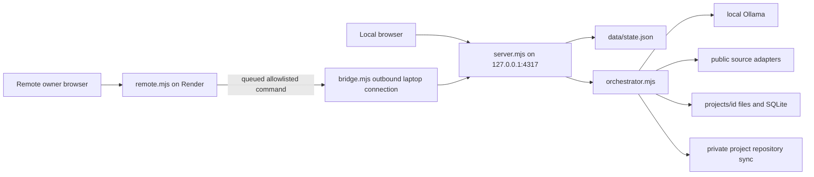

# ForgeRadar V3 audit — 2026-10-15

This audit describes the local source in `outputs/ForgeRadar`, not an assumed deployed build. The existing public Render service is configured by `render.yaml` to run `remote.mjs`; `server.mjs` is the laptop engine. The local directory was not a Git checkout at audit time. No V3 changes have been deployed or pushed.

## Architecture

The project has no npm dependencies; Node 24+ is required for local SQLite. The public service uses Node 22 and only serves the owner dashboard/bridge. `public/index.html`, `app.js`, `console.js`, `outbox.js`, `style.css`, `design.css`, and `design.js` form the existing UI. `fullstack.mjs` and `app-kit.mjs` compile a bounded single-owner CRUD app. `start.ps1`, `worker-supervisor.ps1`, and `daily.mjs` start and schedule local work.

## Feature inventory

| Journey/capability | Actual status | Evidence and V3 gap |
| --- | --- | --- |
| Owner sign-in | Working on remote dashboard | Password and signed 12-hour cookie in `remote.mjs`; no distinct user accounts, roles, onboarding or cross-user isolation. Local engine is loopback-only and unauthenticated. |
| User profile | Partial | Ranking weights and manual settings exist; no consented CV/DOCX extraction, GitHub portfolio review, taxonomy or strict domain exclusions. |
| Discovery | Partial | GitHub, HN, Stack Overflow, Reddit RSS and Mastodon adapters; Bluesky can return 403. Opportunity provenance and publication-vs-retrieval dates are insufficient. OpenAlex/arXiv/Crossref are absent. Current clustering can produce generic/off-topic results. |
| Recommendations | Partial | Weighted heuristic scoring, model evaluation, competition check and proposal. No strict eligibility, source credibility gate, per-user feedback, mode-specific ranking or comparison workspace. |
| Project approval | Working for code generation | New ideas stop at proposal; explicit build approval required. `server.mjs` also has a plan-only project action. Publication/repository sync currently follows successful QA automatically for an approved build; V3 requires a separate release review and explicit public confirmation. |
| Task management | Mostly absent | Generated `TASKS.md` is a file, without persistent CRUD, dependency graph, human acceptance or task history. |
| Local agents | Bounded working pipeline | Sequential logical roles share Ollama; events and handoffs are real. Jobs are persisted only as summary state; crash resumes as interrupted, not a DB-backed queue with checkpoints. |
| Application generation | Bounded working | Offline prototypes and reviewed Node/SQLite CRUD apps; arbitrary backend integrations and embedded hardware builds are not implemented. |
| Validation | Partial | Syntax/scope checks and real CRUD acceptance tests. Domain behavior, browser smoke, dependency audit, tested commit SHA and release evidence are not systematically recorded. |
| Private previews | Working through owner dashboard | Local preview and authenticated remote relay exist; no Tailscale setup or per-preview expiring grants. When laptop is off, work stops. |
| GitHub | Working for private approved projects | Separate private repos and no force push. Public release wizard, secret/branding scan and verified website publication are absent. Platform repo is already public; V3 changes remain local until approved. |
| Visuals | Working Eclipse theme | V3 Nebula and Sunset, user theme persistence, constellation/journey views and full navigation are absent. |
| Tests | 20 passing | `node --test tests.mjs remote-tests.mjs app-kit-tests.mjs` passed 20/20 with loopback access on 2026-10-15. No full V3 acceptance suite. |

## Data preservation and migration

`data/state.json` (approximately 646 KB at audit) holds current opportunities, projects, events, settings and command receipts. `projects/<id>/` contains generated files and project SQLite databases. `data/deployment.json` and `data/render-secrets.env` contain private deployment configuration and are excluded by `.gitignore`. Existing user records and project data must never be seeded over or removed. New V3 SQLite tables should be additive, versioned and transactionally migrated; import from the JSON state must be idempotent. Back up `data/state.json` and project databases before each migration, keep the original JSON readable for rollback, and test recovery on a copy. Development fixtures belong in temporary test directories only.

## Risks and blockers

1. The app is single-owner; real multi-user accounts and server-side tenant isolation require a security redesign before accepting other users.
2. Automatic private GitHub sync after approved builds must be separated from explicit **public** release approval. Existing private project sync is owner-authorized by prior instructions, while this V3 specification prohibits publishing without explicit approval. New V3 release code should be local until reviewed.
3. State is a JSON file plus per-project SQLite, not a unified transactional queue. Browser outbox is local to one browser and remote cloud cache is ephemeral.
4. Existing discovery sources have uneven access and provenance; no connector may be labeled healthy without a successful live fetch. Source terms and free limits require current verification before adding new adapters.
5. Generated apps support reviewed CRUD workflows only. Claims of arbitrary project implementation or hardware verification would be inaccurate.
6. Local engine APIs rely on loopback isolation; any LAN/tunnel mode needs application auth for every API and preview path before exposure.
7. Render free service is already deployed but does not provide local GPU or durable remote state. No new hosting or public exposure is authorized by V3.

## Phase plan and gates

| Phase | Implementation gate |
| --- | --- |
| A Audit & stability | Inventory and risk log, baseline tests, daily launcher fix, verified local backup/restore procedure. |
| B Local foundation | Additive SQLite migrations, durable jobs/scheduler and diagnostics; preserve old state and no paid dependencies. |
| C Profiles | Real account isolation, consented onboarding and safe document/portfolio import, tested cross-user separation. |
| D Discovery | Verified compliant sources, source dates/provenance, strict hard domain filter, feedback, compare/research/skill flows. |
| E Building | Editable proposal and persistent task graph, bounded local agents, manual fallback and approval gates. |
| F Validation/access | Evidence-backed checks and authenticated owner remote previews through a verified free mode. |
| G Publication | Separate explicit public-release approval, staged repo review, scans, truthful README and verified deployment choices. |
| H Visual experience | Functional Nebula and Sunset across all shipped flows, accessible responsive views and measured performance. |

## $0 dependency ledger

| Service/dependency | Purpose | Cost/free limit | Online? | Data exposure | Core? |
| --- | --- | --- | --- | --- | --- |
| Node.js 24+, built-in SQLite | Server and local database | Free/open source; laptop capacity limits | No | Local | Yes |
| Ollama + locally installed model | AI stages | Free runtime/model subject to model license and hardware | No after download | Local prompts | Optional, manual fallback required in V3 |
| GitHub | Existing private repositories, optional public release | Free account quotas apply; verify before added release paths | Yes | Authorized source/artifacts | Optional |
| Public research/community endpoints | Fresh discovery | Provider-specific quotas/terms; verify before new wiring | Yes | Queries and IP | Optional; cached/offline mode required |
| Render existing free service | Current protected owner dashboard relay | Free tier may sleep/limit usage; no uptime promise | Yes | Dashboard state/commands, no local model credentials | Optional |
| Tailscale Personal | Candidate private-device access | Eligibility and current free-device limits must be verified before setup | Yes | VPN metadata and routed traffic | Optional |

No paid API, database, analytics service or domain is required by the current local app. New V3 capabilities must retain this property.

## Research connector review (2026-10-15)

OpenAlex's [current API reference](https://help.openalex.org/api/) permits basic keyless queries and describes a free daily budget; a free key is optional for larger use. Crossref's [REST API guidance](https://www.crossref.org/documentation/retrieve-metadata/rest-api/tips-for-using-the-crossref-rest-api) says to cache results and back off on HTTP 429; its [public API documentation](https://github.com/CrossRef/rest-api-doc) describes the free public pool and response rate-limit headers. V3 currently implements only bounded, opt-in OpenAlex and Crossref metadata queries (five results per provider/query, 24-hour local cache). It never asks for paid access. arXiv and additional connectors remain disabled until their current access rules and integration are verified. These research records are evidence, not AI-generated project proposals, and retain distinct publication and retrieval dates.
